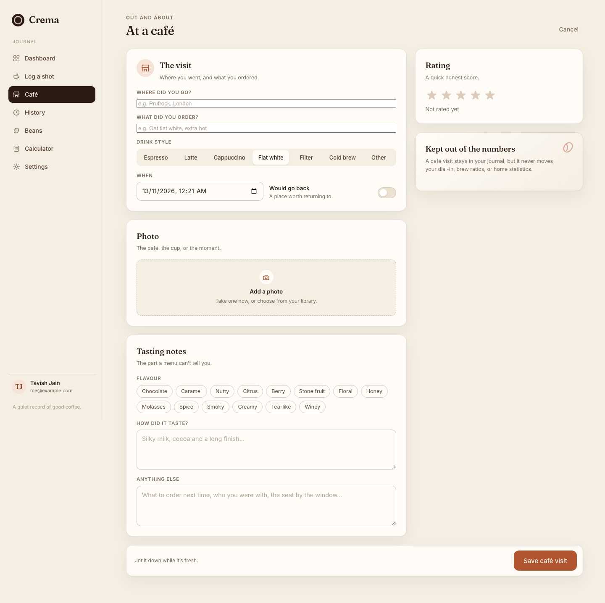
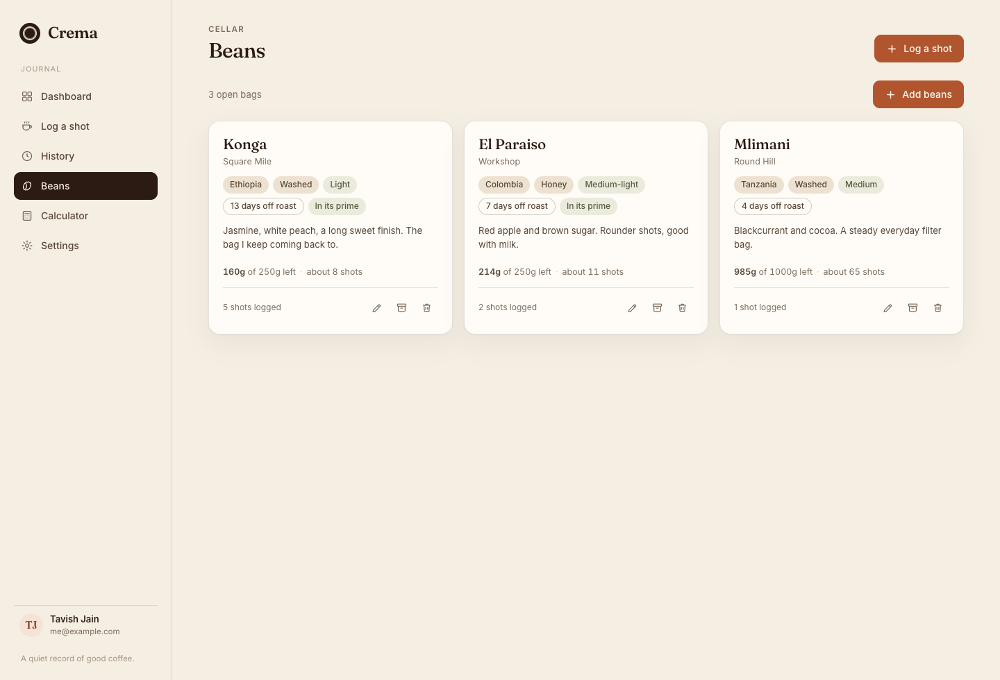
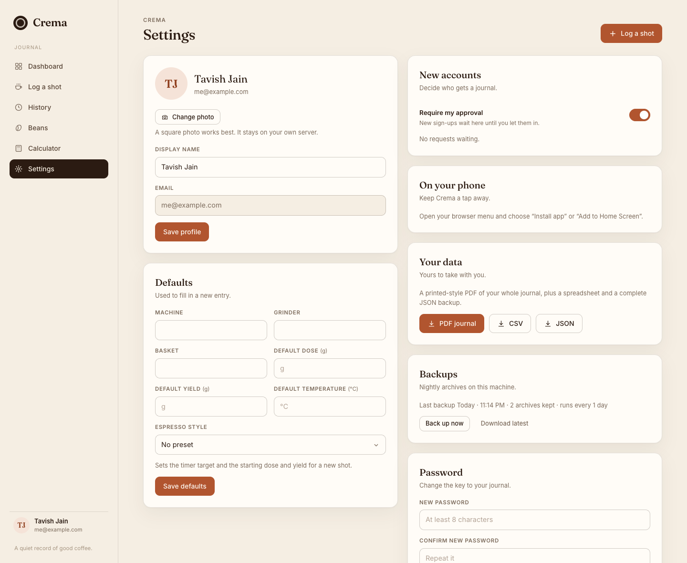
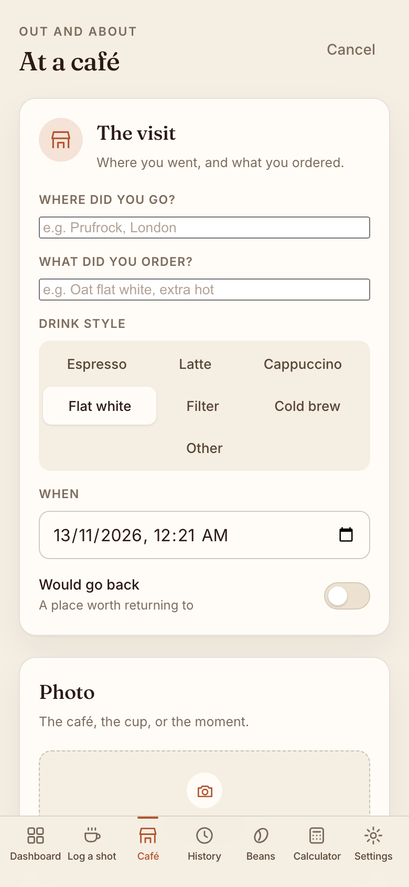
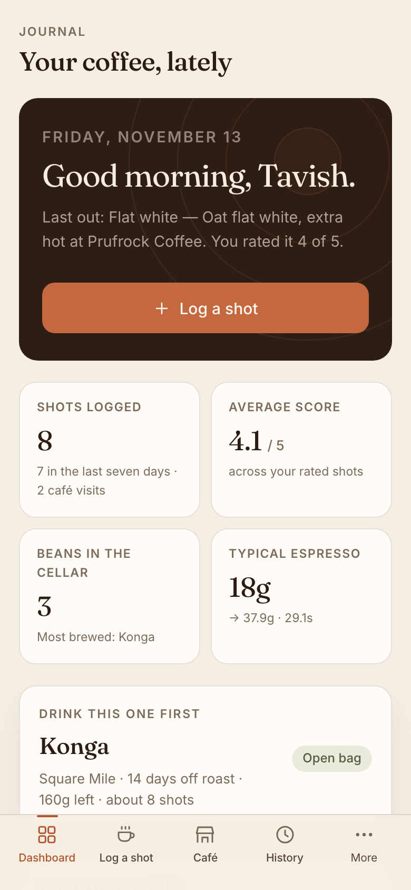
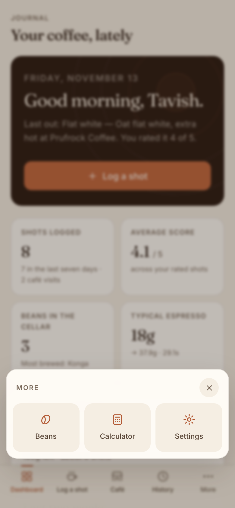

# Crema

A small, self-hosted coffee journal for espresso, milk drinks, and filter brews.

Crema is a single-user-per-account journal you run on your own hardware. Log a shot while it is fresh, keep the bags and tasting notes together, and export the whole thing as a designed PDF that looks like a little printed book. It installs as a PWA, works on phone and laptop, keeps a read-only copy of your last sync for offline reading, and holds new shots on the device until the server is reachable again.

No ads, no tracking, no third-party services. Your data stays in a SQLite file on your own disk — and, if you want, in a Google Drive folder you control.

**Sample journal:** [crema-sample-journal.pdf](static/crema-sample-journal.pdf)

## Screenshots

| Dashboard | Shot history |
| --- | --- |
|  |  |

| Logging a shot | At a café |
| --- | --- |
|  |  |

| Beans and stock | Profile and settings |
| --- | --- |
|  |  |

| Café visits on mobile | Mobile navigation |
| --- | --- |
|  |  |

| More menu | Sign in |
| --- | --- |
|  |  |

## Features

- **Espresso, milk drinks, filter, cold brew.** Dose, yield, ratio, time, grind, temperature, pressure, pre-infusion, machine, grinder, basket.
- **Brew timer with dial-in advice.** Pick a style — ristretto, single, double, lungo — and the target time, dose, and yield set themselves to match. Start it as the pump kicks in; stopping it fills in shot time. The notes underneath measure the shot against that style and suggest a grind change or a yield correction in plain words.
- **Tasting notes that stay useful.** Rating, free-text notes, flavour tags, and five balance sliders (acidity, body, sweetness, bitterness, aftertaste).
- **Bag stock.** Give a bag its size in grams and Crema works out what is left and roughly how many shots remain, using your average dose for that coffee. The dashboard points at the open bag that will go stale first.
- **Café log.** A separate page for coffee you drank out: the place, what you ordered, the drink style, a photo, tasting notes, and whether you would go back. Café visits stay in the journal but never move your averages, dial-in advice, or brewing stats.
- **Offline writes.** Log a shot with no signal; it is queued on the device and uploaded when Crema is reachable. A client id per entry keeps retries from logging it twice.
- **Photos.** Attach one photo per shot — the cup, the bag, or the dial-in.
- **Your own profile picture.** Upload it from settings; it appears in the sidebar and stays on your own disk.
- **Bean cellar.** Roaster, origin, process, varietal, roast level, roast date, notes, and archive support.
- **History and stats.** Search past shots, filter by method or bean, and see simple trends.
- **Dial-in calculator.** Scale a recipe by dose or yield without leaving the page.
- **Exports.** CSV, JSON, or a multi-page designed PDF journal with photos, recipes, tasting notes, balance meters, and a cellar table.
- **Automatic backups.** Crema writes a consistent zip of the database and photos every night, keeps the last 14, and lets the owner download or trigger one from Settings. Point `rclone` at the folder to copy them into Google Drive.
- **Accounts.** Each person gets a private journal. The owner account can require approval for new sign-ups.
- **PWA.** Installable, mobile-first, with offline reading, a queue for new shots, and a five-item mobile bar with a More menu.
- **Small footprint.** Flask + SQLite, no external database or services. Backups run inside the app process.

## Quick start

### Docker, no source needed

The image is published on Docker Hub for both `amd64` and `arm64` (Intel/AMD servers, Raspberry Pi, Apple Silicon):

```bash
docker run -d --name crema --restart unless-stopped \
  -p 8787:8787 \
  -e CREMA_ADMIN_EMAIL=you@example.com \
  -v crema-data:/data \
  tavishjain2807/crema:latest
```

Open <http://localhost:8787>, create your account, and start logging.

That uses a named volume (`crema-data`). To keep the data in a folder you can see and back up, swap the last two lines for `-v "$PWD/crema-data:/data"`.

The same thing in Compose:

```yaml
services:
  crema:
    image: tavishjain2807/crema:latest
    container_name: crema
    restart: unless-stopped
    ports:
      - "8787:8787"
    environment:
      CREMA_ADMIN_EMAIL: you@example.com
      CREMA_PDF_FOOTER: Made at home · Crema
    volumes:
      - ./data:/data
```

Pin a version with `tavishjain2807/crema:1.2` (or `:1.2.1`) to avoid surprise upgrades.

### Docker from source

```bash
git clone https://github.com/TavishJain2807/crema.git
cd crema
cp .env.example .env      # set CREMA_ADMIN_EMAIL to your own address
docker compose up -d --build
```

Data lives in `./data` next to `docker-compose.yml`. Back that directory up and you have everything.

### Without Docker

Requires Python 3.10 or newer.

```bash
git clone https://github.com/TavishJain2807/crema.git
cd crema

python3 -m venv .venv
source .venv/bin/activate
pip install -r requirements.txt

export CREMA_ADMIN_EMAIL=you@example.com
export COFFEE_DATA_DIR="$PWD/data"

gunicorn --workers 2 --threads 4 --bind 127.0.0.1:8787 --timeout 45 app:app
```

For a quick look you can also run `python app.py`, which starts Flask's development server on `127.0.0.1:8787` with debug mode on. Do not expose that to a network.

## Set the owner account

The account-approval controls appear only for the address in `CREMA_ADMIN_EMAIL`. It is matched case-insensitively.

1. Set `CREMA_ADMIN_EMAIL` **before first start**, or register your account first and set it later.
2. Restart the app.
3. Sign in with that account. **Settings → New accounts** now lets you:
   - turn **Require my approval** on or off;
   - approve or decline pending sign-ups.

When an owner address is configured, approval defaults to **on**: new registrations are stored as `pending`, cannot sign in, and do not receive a session. The owner address itself is always created active, so a fresh install cannot lock you out. When no owner address is configured, approval is forced off so an install can never gate sign-ups with nobody able to approve them.

Up to 25 requests can wait at once. Approval and decline actions are owner-only; the endpoints return `404` to every other account.

## Configuration

| Variable | Default | Purpose |
| --- | --- | --- |
| `COFFEE_DATA_DIR` | `./data` | Directory for `crema.sqlite3`, `photos/`, and `backups/`. Use an absolute path in production. |
| `CREMA_ADMIN_EMAIL` | *(empty)* | Owner account. Enables the approval toggle, pending list, and backup controls. |
| `CREMA_PDF_FOOTER` | `Made at home · Crema` | Left-hand footer text on exported PDFs. |
| `CREMA_BACKUP` | `1` | Set to `0` to turn off the nightly backup thread (manual downloads still work). |
| `CREMA_BACKUP_HOURS` | `24` | Hours between automatic backups. `0` disables the schedule. |
| `CREMA_BACKUP_KEEP` | `14` | How many zip archives to keep in `backups/`. |

Database migrations run automatically on start. The app adds missing tables and columns; existing data is preserved.

## Put it online

Crema speaks plain HTTP on `127.0.0.1:8787`. Put a reverse proxy in front of it so traffic is HTTPS — service workers, installation, and secure cookies need it.

**Caddy** (automatic certificates):

```bash
sudo cp deploy/Caddyfile /etc/caddy/Caddyfile   # edit the hostname first
sudo systemctl reload caddy
```

**nginx:** see [`deploy/nginx.conf`](deploy/nginx.conf). Add TLS with certbot or your own certificates.

**systemd:** [`deploy/crema.service`](deploy/crema.service) is a starting point for a non-Docker install. It runs as an unprivileged `crema` user, binds to localhost only, and expects the code in `/opt/crema` and data in `/var/lib/crema`:

```bash
sudo useradd --system --home /opt/crema --shell /usr/sbin/nologin crema
sudo mkdir -p /opt/crema /var/lib/crema
sudo chown -R crema:crema /opt/crema /var/lib/crema
# copy the project to /opt/crema, create the venv as the crema user, edit the unit
sudo cp deploy/crema.service /etc/systemd/system/crema.service
sudo systemctl daemon-reload
sudo systemctl enable --now crema
```

`app.py` already trusts one layer of `X-Forwarded-*` headers via Werkzeug's `ProxyFix`, so client IPs and HTTPS scheme are reported correctly behind either proxy.

## Data and backups

Everything lives in `COFFEE_DATA_DIR`:

```
data/
├── crema.sqlite3          # accounts, beans, shots, sessions, settings
├── crema.sqlite3-wal      # SQLite write-ahead log (normal)
├── crema.sqlite3-shm
├── photos/
│   ├── <user>-<shot>-<token>.jpg
│   └── <user>-<shot>-<token>-thumb.jpg
└── backups/
    └── crema-YYYYmmdd-HHMMSS.zip
```

### Nightly archives

Crema backs itself up in the background: shortly after startup, then every 24 hours (`CREMA_BACKUP_HOURS`). Each archive is a zip containing a consistent SQLite snapshot and every photo. The last 14 are kept (`CREMA_BACKUP_KEEP`).

**Settings → Backups** shows the last run and the archives kept, writes one on demand with **Back up now**, and downloads the newest with **Download latest**. Archives are owner-only.

The archive is written under the data directory, so it survives app updates but not a dead disk. For a second copy, upload them somewhere else — for example Google Drive with `rclone`.

### Copy the archives to Google Drive

`rclone` talks to Drive directly, so no Google credentials live inside Crema.

1. Install rclone on the machine running Crema: `sudo apt install rclone` (or see [rclone.org/install](https://rclone.org/install/)).
2. Run `rclone config` as the user that runs Crema (or copy the resulting `rclone.conf` into that user's home). Create a new remote named `gdrive` and choose **Google Drive**. When it prints an authorize URL, open it in a browser on any machine, approve access, and paste the code back.

   For a durable setup, create your own OAuth client instead of using rclone's shared one: enable the Drive API in the Google Cloud console, make a **Desktop app** client, and give rclone its ID and secret. Set the redirect URI to `http://127.0.0.1:53682/`. Google is retiring rclone's shared client, so a custom one avoids a future interruption; leaving the fields blank works in the meantime.
3. Check it: `rclone lsd gdrive:`
4. Copy the archives nightly with a systemd timer. Save this as `/etc/systemd/system/crema-drive.service`:

   ```ini
   [Unit]
   Description=Copy Crema backups to Google Drive

   [Service]
   Type=oneshot
   User=crema
   ExecStart=/usr/bin/rclone copy /var/lib/crema/backups gdrive:"Crema Backups" --max-age 30d
   ```

   And `/etc/systemd/system/crema-drive.timer`:

   ```ini
   [Unit]
   Description=Nightly Crema backup upload

   [Timer]
   OnCalendar=*-*-* 04:30:00
   Persistent=true

   [Install]
   WantedBy=timers.target
   ```

   ```bash
   sudo systemctl daemon-reload
   sudo systemctl enable --now crema-drive.timer
   ```

   `Persistent=true` runs a missed copy after the machine wakes. `--max-age 30d` limits each upload to recent archives; remove it if you would rather mirror everything.

5. After the first night, `gdrive:Crema Backups` should hold at least one `crema-*.zip`.

### Manual snapshots

You can still take one yourself:

```bash
sqlite3 data/crema.sqlite3 ".backup '/path/to/crema-$(date +%F).sqlite3'"
cp -a data/photos /path/to/photos-$(date +%F)
```

With Docker, copy the data directory from the volume, or run the backup inside the container (`docker compose exec crema ...`) and copy the files out.

To restore, stop Crema, replace `crema.sqlite3` and `photos/`, then start it again. Sessions live in the database, so everyone signs in once more.

Photos are capped at 10 MB and requests at 14 MB. Increase `client_max_body_size` if you raise those limits.

## The PDF journal

**Settings → PDF journal** (or `GET /api/export.pdf`) builds an A4 journal from your shots: a cover with stats and a "best cup" card, two shots per page with photos and full recipe grids, balance meters, and a bean-cellar table at the end. It uses ReportLab and the bundled Fraunces and Inter fonts, so it works offline and needs no browser.

The checked-in `static/crema-sample-journal.pdf` is generated from demo data and is linked from the sign-in screen. It is safe to keep as a showcase, or delete it and remove the link in `static/app.js`.

## PWA and offline mode

Crema registers a service worker and caches the app shell. After a successful sync it stores a snapshot of your most recent data, so the app opens and shows your last journal when the network is down.

New shots are the exception to "read-only": if the server cannot be reached, the shot is saved in IndexedDB on that device and a banner counts what is waiting. It uploads when you reconnect, press **Upload now**, or reopen the app with a connection. Each queued shot carries a client id, so a retry that did reach the server is recognised and never logged twice. Edits to existing shots still need a connection.

Installing:

- **iOS Safari:** Share → Add to Home Screen.
- **Android Chrome:** menu → Install app.
- **Desktop Chrome/Edge:** install icon in the address bar.

Offline mode requires HTTPS (or `localhost`). If the banner says you are offline while other sites work, check that the hostname resolves and that any VPN carries IPv6 if your server only has an IPv6 address.

## Updating

```bash
docker pull tavishjain2807/crema:latest && docker compose up -d   # published image
git pull && docker compose up -d --build                          # from source
# or: pip install -r requirements.txt && sudo systemctl restart crema
```

The schema upgrade is idempotent and runs at startup. Take a backup first if you are jumping several versions.

## Troubleshooting

| Symptom | Fix |
| --- | --- |
| "Your account is waiting for approval" | Sign in as the owner and approve it under **Settings → New accounts**, or clear `CREMA_ADMIN_EMAIL` to disable approval. |
| No approval card in Settings | `CREMA_ADMIN_EMAIL` is empty or does not match the signed-in address exactly. Restart after changing it. |
| PDF export is empty or a button does nothing | Add at least one shot. The export only includes your own data. |
| `413 Request is too large` | Raise the proxy body limit (nginx `client_max_body_size`, Caddy has no default limit). |
| Offline banner appears while online | Confirm the host is reachable from that device, including IPv6 if applicable. The app clears the banner on the next successful request. |
| A queued shot never uploads | Open the app while online and press **Upload now**. If the entry is permanently rejected it is dropped with a message rather than retried forever. |
| No backup card in Settings | Backups are owner-only. Sign in with the address in `CREMA_ADMIN_EMAIL`. |
| `No backup yet` after a day | Check the app log for `Automatic backup failed`. The data directory must be writable and have room for the database plus photos. |
| Login fails after restoring a backup | Sessions are stored in the database; sign in again. |

## Project layout

```
app.py                 Flask app, API, schema, PDF route, static hosting
pdf_export.py          ReportLab journal generator
static/
├── index.html         App shell
├── app.js             Vanilla-JS SPA
├── styles.css
├── sw.js              Service worker
├── manifest.webmanifest
├── fonts/             Fraunces + Inter (SIL OFL)
└── crema-sample-journal.pdf
deploy/                systemd unit, Caddyfile, nginx example
.github/workflows/     smoke tests, Docker Hub publish
Dockerfile
docker-compose.yml
```

## Security notes

- Passwords are hashed with Werkzeug's default (scrypt). Sessions are random 256-bit tokens, stored hashed, and expire after 60 days.
- There is no password-reset email flow. If someone loses their password, an owner can remove the account from the database and let them register again.
- Registration has a pending-request cap but no per-IP rate limit. If you expect public traffic, add rate limiting at the proxy (Caddy `rate_limit`, nginx `limit_req`) or keep registration approval on.
- Run Crema behind HTTPS and do not expose the development server.
- SQLite is fine for a household. It is not designed for thousands of concurrent writers.

## Contributing

Issues and pull requests are welcome. Keep changes small and in the style of the existing code: plain JavaScript, no build step, no framework.

```bash
python -m unittest discover -s tests -v
```

See [`CONTRIBUTING.md`](CONTRIBUTING.md). The smoke tests spin up the app against a temporary database and cover registration, approval, logging a shot, bag stock, café entries, offline retry ids, backups, and exports.

## License

[MIT](LICENSE) © 2026 Tavish Jain.

Bundled fonts: [Fraunces](https://github.com/undercasetype/Fraunces) and [Inter](https://github.com/rsms/inter), both under the SIL Open Font License 1.1 (see `static/fonts/OFL.txt` and `static/fonts/OFL-Inter.txt`). The sample journal uses demo data and sample photos.
