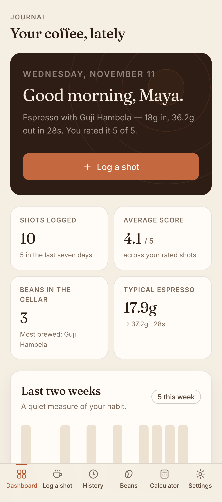
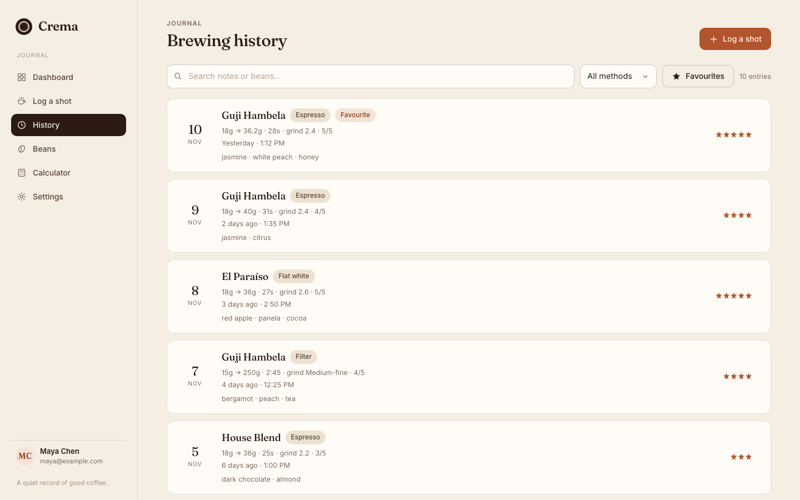
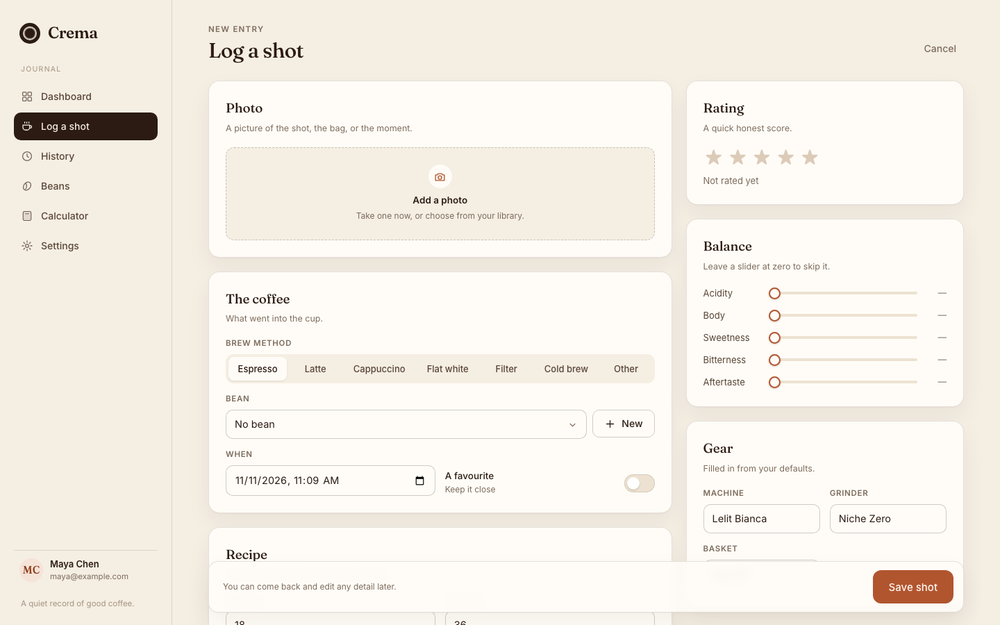
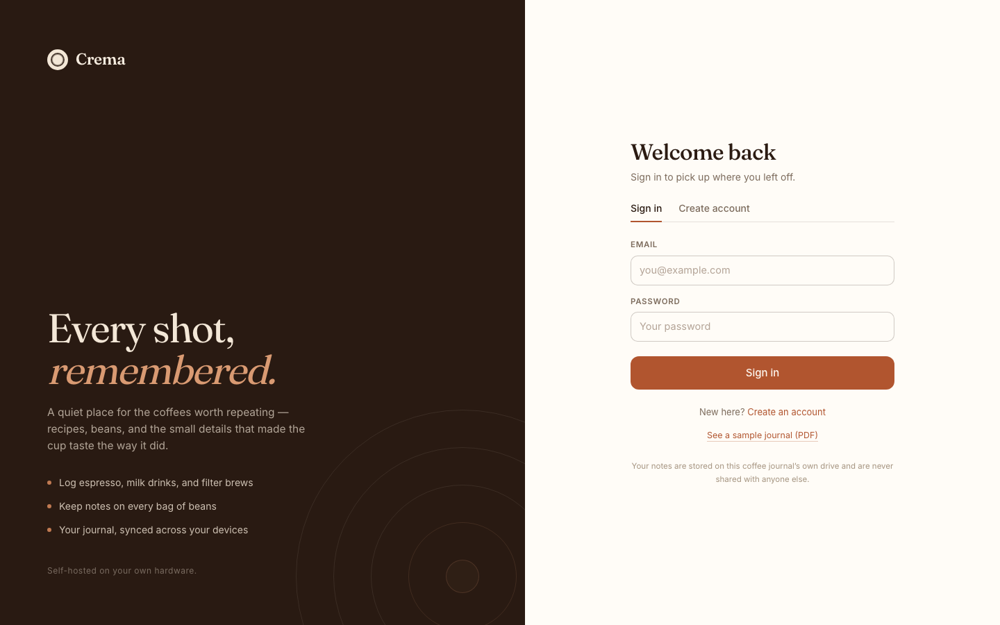

# Crema

A small, self-hosted coffee journal for espresso, milk drinks, and filter brews.

Crema is a single-user-per-account journal you run on your own hardware. Log a shot while it is fresh, keep the beans and tasting notes together, and export the whole thing as a designed PDF that looks like a little printed book. It installs as a PWA, works on phone and laptop, and keeps a read-only copy of your last sync for offline reading.

No ads, no tracking, no third-party services. Your data stays in a SQLite file on your own disk.

**Sample journal:** [crema-sample-journal.pdf](static/crema-sample-journal.pdf)

## Screenshots

| Dashboard | Shot history |
| --- | --- |
|  |  |

| Logging a shot | Sign in |
| --- | --- |
|  |  |

## Features

- **Espresso, milk drinks, filter, cold brew.** Dose, yield, ratio, time, grind, temperature, pressure, pre-infusion, machine, grinder, basket.
- **Tasting notes that stay useful.** Rating, free-text notes, flavour tags, and five balance sliders (acidity, body, sweetness, bitterness, aftertaste).
- **Photos.** Attach one photo per shot — the cup, the bag, or the dial-in.
- **Bean cellar.** Roaster, origin, process, varietal, roast level, roast date, and notes, with archive support.
- **History and stats.** Search past shots, filter by method or bean, and see simple trends.
- **Dial-in calculator.** Scale a recipe by dose or yield without leaving the page.
- **Exports.** CSV, JSON, or a multi-page designed PDF journal with photos, recipes, tasting notes, balance meters, and a cellar table.
- **Accounts.** Each person gets a private journal. The owner account can require approval for new sign-ups.
- **PWA.** Installable, mobile-first, with an offline read-only snapshot of the last sync.
- **Small footprint.** Flask + SQLite, no external database or background workers.

## Quick start

### Docker (recommended)

```bash
git clone https://github.com/yourname/crema.git
cd crema
cp .env.example .env      # set CREMA_ADMIN_EMAIL to your own address
docker compose up -d --build
```

Open <http://localhost:8787>, create your account, and start logging.

Data lives in `./data` next to `docker-compose.yml`. Back that directory up and you have everything.

### Without Docker

Requires Python 3.10 or newer.

```bash
git clone https://github.com/yourname/crema.git
cd crema

python3 -m venv .venv
source .venv/bin/activate
pip install -r requirements.txt

export CREMA_ADMIN_EMAIL=you@example.com
export COFFEE_DATA_DIR="$PWD/data"

gunicorn --workers 2 --threads 4 --bind 127.0.0.1:8787 --timeout 45 app:app
```

For a quick look you can also run `python app.py`, which starts Flask's development server on `127.0.0.1:8787` with debug mode on. Do not expose that to a network.

## Set the owner account

The account-approval controls appear only for the address in `CREMA_ADMIN_EMAIL`. It is matched case-insensitively.

1. Set `CREMA_ADMIN_EMAIL` **before first start**, or register your account first and set it later.
2. Restart the app.
3. Sign in with that account. **Settings → New accounts** now lets you:
   - turn **Require my approval** on or off;
   - approve or decline pending sign-ups.

When an owner address is configured, approval defaults to **on**: new registrations are stored as `pending`, cannot sign in, and do not receive a session. The owner address itself is always created active, so a fresh install cannot lock you out. When no owner address is configured, approval is forced off so an install can never gate sign-ups with nobody able to approve them.

Up to 25 requests can wait at once. Approval and decline actions are owner-only; the endpoints return `404` to every other account.

## Configuration

| Variable | Default | Purpose |
| --- | --- | --- |
| `COFFEE_DATA_DIR` | `./data` | Directory for `crema.sqlite3` and `photos/`. Use an absolute path in production. |
| `CREMA_ADMIN_EMAIL` | *(empty)* | Owner account. Enables the approval toggle and pending list. |
| `CREMA_PDF_FOOTER` | `Made at home · Crema` | Left-hand footer text on exported PDFs. |

Database migrations run automatically on start. The app adds missing tables and columns; existing data is preserved.

## Put it online

Crema speaks plain HTTP on `127.0.0.1:8787`. Put a reverse proxy in front of it so traffic is HTTPS — service workers, installation, and secure cookies need it.

**Caddy** (automatic certificates):

```bash
sudo cp deploy/Caddyfile /etc/caddy/Caddyfile   # edit the hostname first
sudo systemctl reload caddy
```

**nginx:** see [`deploy/nginx.conf`](deploy/nginx.conf). Add TLS with certbot or your own certificates.

**systemd:** [`deploy/crema.service`](deploy/crema.service) is a starting point for a non-Docker install. It runs as an unprivileged `crema` user, binds to localhost only, and expects the code in `/opt/crema` and data in `/var/lib/crema`:

```bash
sudo useradd --system --home /opt/crema --shell /usr/sbin/nologin crema
sudo mkdir -p /opt/crema /var/lib/crema
sudo chown -R crema:crema /opt/crema /var/lib/crema
# copy the project to /opt/crema, create the venv as the crema user, edit the unit
sudo cp deploy/crema.service /etc/systemd/system/crema.service
sudo systemctl daemon-reload
sudo systemctl enable --now crema
```

`app.py` already trusts one layer of `X-Forwarded-*` headers via Werkzeug's `ProxyFix`, so client IPs and HTTPS scheme are reported correctly behind either proxy.

## Data and backups

Everything lives in `COFFEE_DATA_DIR`:

```
data/
├── crema.sqlite3          # accounts, beans, shots, sessions, settings
├── crema.sqlite3-wal      # SQLite write-ahead log (normal)
├── crema.sqlite3-shm
└── photos/
    ├── <user>-<shot>-<token>.jpg
    └── <user>-<shot>-<token>-thumb.jpg
```

Back up the whole directory, or take a consistent snapshot of the database while the app is running:

```bash
sqlite3 data/crema.sqlite3 ".backup '/path/to/crema-$(date +%F).sqlite3'"
cp -a data/photos /path/to/photos-$(date +%F)
```

With Docker, either stop the container briefly or run the backup inside it (`docker compose exec crema ...`) and copy the files out.

To restore, stop Crema, replace `crema.sqlite3` and `photos/`, then start it again.

Photos are capped at 10 MB and requests at 14 MB. Increase `client_max_body_size` if you raise those limits.

## The PDF journal

**Settings → PDF journal** (or `GET /api/export.pdf`) builds an A4 journal from your shots: a cover with stats and a "best cup" card, two shots per page with photos and full recipe grids, balance meters, and a bean-cellar table at the end. It uses ReportLab and the bundled Fraunces and Inter fonts, so it works offline and needs no browser.

The checked-in `static/crema-sample-journal.pdf` is generated from demo data and is linked from the sign-in screen. It is safe to keep as a showcase, or delete it and remove the link in `static/app.js`.

## PWA and offline mode

Crema registers a service worker and caches the app shell. After a successful sync it stores a read-only snapshot of your most recent data, so the app opens and shows your last journal when the network is down. Writes always need the server.

Installing:

- **iOS Safari:** Share → Add to Home Screen.
- **Android Chrome:** menu → Install app.
- **Desktop Chrome/Edge:** install icon in the address bar.

Offline mode requires HTTPS (or `localhost`). If the banner says you are offline while other sites work, check that the hostname resolves and that any VPN carries IPv6 if your server only has an IPv6 address.

## Updating

```bash
git pull
docker compose up -d --build     # Docker
# or: pip install -r requirements.txt && sudo systemctl restart crema
```

The schema upgrade is idempotent and runs at startup. Take a backup first if you are jumping several versions.

## Troubleshooting

| Symptom | Fix |
| --- | --- |
| "Your account is waiting for approval" | Sign in as the owner and approve it under **Settings → New accounts**, or clear `CREMA_ADMIN_EMAIL` to disable approval. |
| No approval card in Settings | `CREMA_ADMIN_EMAIL` is empty or does not match the signed-in address exactly. Restart after changing it. |
| PDF export is empty or a button does nothing | Add at least one shot. The export only includes your own data. |
| `413 Request is too large` | Raise the proxy body limit (nginx `client_max_body_size`, Caddy has no default limit). |
| Offline banner appears while online | Confirm the host is reachable from that device, including IPv6 if applicable. The app clears the banner on the next successful request. |
| Login fails after restoring a backup | Sessions are stored in the database; sign in again. |

## Project layout

```
app.py                 Flask app, API, schema, PDF route, static hosting
pdf_export.py          ReportLab journal generator
static/
├── index.html         App shell
├── app.js             Vanilla-JS SPA
├── styles.css
├── sw.js              Service worker
├── manifest.webmanifest
├── fonts/             Fraunces + Inter (SIL OFL)
└── crema-sample-journal.pdf
deploy/                systemd unit, Caddyfile, nginx example
Dockerfile
docker-compose.yml
```

## Security notes

- Passwords are hashed with Werkzeug's default (scrypt). Sessions are random 256-bit tokens, stored hashed, and expire after 60 days.
- There is no password-reset email flow. If someone loses their password, an owner can remove the account from the database and let them register again.
- Registration has a pending-request cap but no per-IP rate limit. If you expect public traffic, add rate limiting at the proxy (Caddy `rate_limit`, nginx `limit_req`) or keep registration approval on.
- Run Crema behind HTTPS and do not expose the development server.
- SQLite is fine for a household. It is not designed for thousands of concurrent writers.

## Contributing

Issues and pull requests are welcome. Keep changes small and in the style of the existing code: plain JavaScript, no build step, no framework.

```bash
python -m unittest discover -s tests -v
```

See [`CONTRIBUTING.md`](CONTRIBUTING.md). The smoke tests spin up the app against a temporary database and cover registration, approval, logging a shot, and exports.

## License

[MIT](LICENSE) © 2026 Tavish Jain.

Bundled fonts: [Fraunces](https://github.com/undercasetype/Fraunces) and [Inter](https://github.com/rsms/inter), both under the SIL Open Font License 1.1 (see `static/fonts/OFL.txt` and `static/fonts/OFL-Inter.txt`). The sample journal uses demo data and sample photos.
